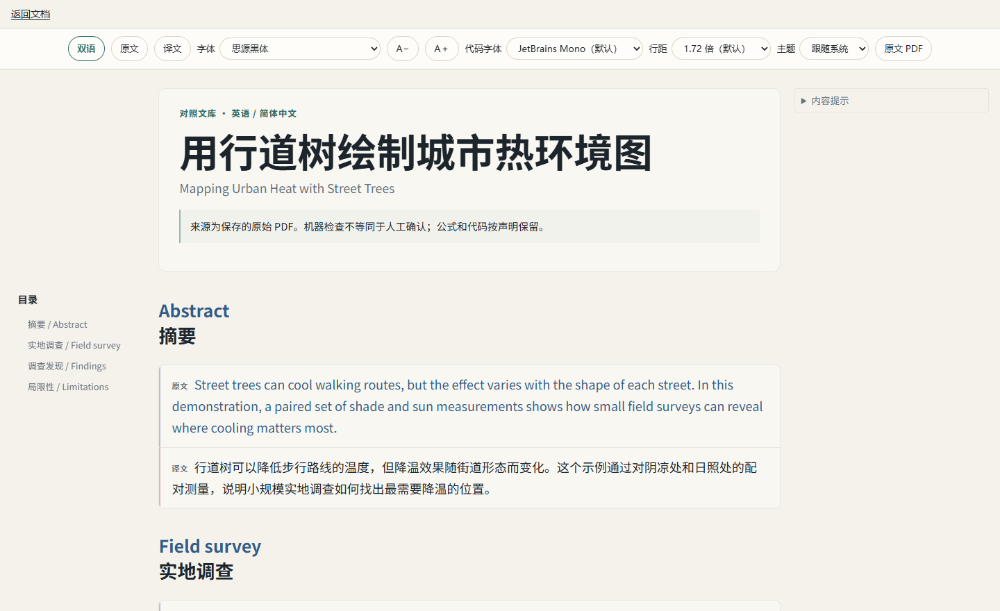
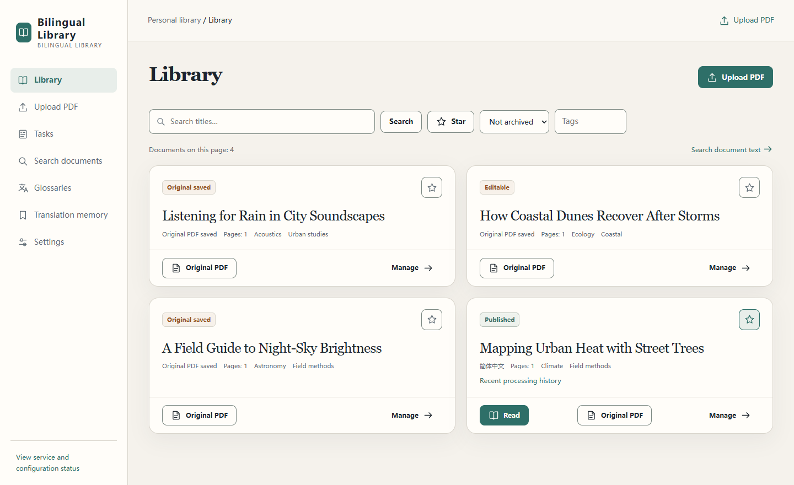
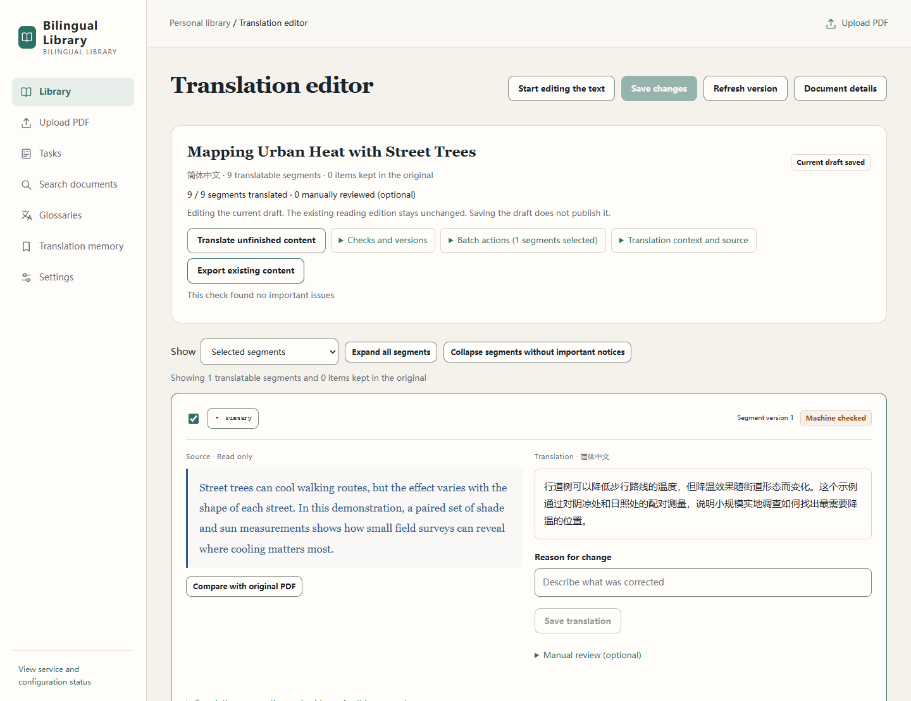

# MultilingualPaperVault · 对照文库

Translate and read research papers in your own PDF library. Compare the translation
with the original, edit passages, and save reading editions for offline use.

[Quick start](#quick-start) · [User guide](docs/usage.md) · [More screenshots](#screenshots)



*The bilingual reader, shown with an authored sample paper and translation.*

## Quick start

Use Git and Docker Engine 28 or later with Compose. Set up a compatible Docker
Model Runner backend before parsing your first PDF. The installation guide
covers hardware requirements and Windows PowerShell commands. [Installation](docs/installation.md)

For a new installation, run these commands in Bash.

```bash
git clone -c core.autocrlf=false https://github.com/rangermix/MultilingualPaperVault.git
cd MultilingualPaperVault
cp compose.example.yaml compose.yaml
```

Configure your parser backend in the local Compose setup, then build and start
the library. [Parser setup](docs/deployment/extraction-acceleration.md)

```bash
docker compose config --quiet
docker compose build app parser db
docker compose up -d --wait
docker compose ps
```

Open the local library. In **Settings → PDF parsing**, choose and prepare a parser,
then upload a PDF. To translate it, first save a translation API service or set up
an optional local model. [Open the library](http://127.0.0.1:8080)

Keep the default loopback address for local use. Anyone who can reach the app has
full access to the library. [Security](SECURITY.md)

## Using the library

- **Organize papers** with search, tags, stars, and an archive.
- **Read in your preferred language.** Create a source-only edition or choose a
  target language. Translation API calls may incur charges.
- **Compare and edit.** Check passages, tables, and equations against the PDF.
  Correct extraction or edit the translation while keeping earlier editions.
- **Take papers offline.** Export a self-contained HTML page or a resource bundle.

Follow the full workflow from your first upload through publication and export.
[Using the library](docs/usage.md)

## Screenshots

### Document library



### Translation editor



## Help and updates

- [Troubleshoot startup and processing](docs/troubleshooting.md)
- [Back up and update an existing installation](docs/installation.md#updating-an-existing-instance)
- [Browse deployment and contribution guides](docs/README.md)

## License

Copyright (c) 2026 Fengqing Liu. Paper Translation uses AGPL-3.0-only. [License](LICENSE)

Bundled third-party materials retain their own licenses. [Third-party notices](THIRD_PARTY_NOTICES.md)
